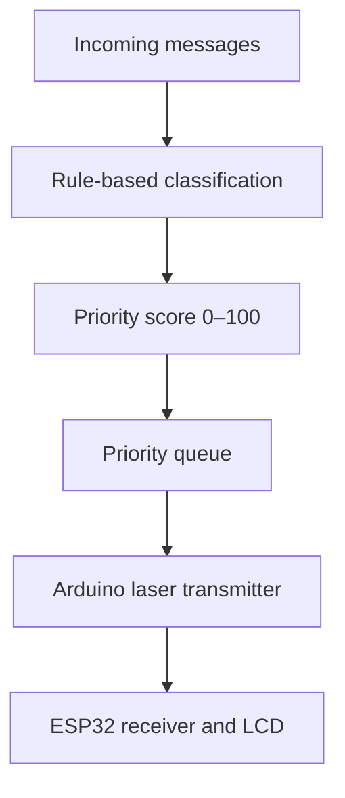

Priority-Based Laser Communication

## Goal

Our project sends messages over a low-bandwidth optical link using a laser transmitter and an ESP32 receiver. Rather than sending every message strictly in arrival order, a **rule-based priority scheduler** sends urgent information first, reducing its time spent waiting in the queue.

## How it works



1. Python reads incoming messages and checks them against configurable phrase patterns.
2. Each message receives a priority score based on its urgency. Basic negation checks help avoid false alarms such as “No fire detected.”
3. A **max-priority queue**, implemented with Python's `heapq`, selects the highest-priority waiting message. Ties are resolved by arrival order (FIFO).
4. Messages are prepared for transmission using the existing laser communication system. A new emergency can move ahead of waiting messages, but an in-progress transmission is not interrupted.

| Example category | Score | Example |
| --- | ---: | --- |
| Emergency | 96 | Fire detected; oxygen below safe limits |
| Critical | 89 | Main power supply failure |
| High | 72 | Unauthorized access detected |
| Medium | 55 | Cooling efficiency reduced |
| Low | 22 | Battery level at 87% |
| Informational | 15 | Routine maintenance scheduled |

## Implementation

- **Language:** Python 3.10+; standard library only (no external packages or LLM).
- **`priority_scheduler.py`:** message classification and heap-based queue.
- **`main.py`:** input handling, ranking, and FIFO comparison.
- **`messages.txt`:** 30 simulated monitoring-station messages.
- **`test_scheduler.py`:** checks urgency ordering, FIFO ties, dynamic insertion, and basic negation.

Run from the project folder:

```bash
python main.py
python -m unittest -v test_scheduler.py
```

Outputs: `ranking.json` (scores and explanations) and `transmit_order.txt` (one message per line). Each queue insertion/removal is **O(log n)**, excluding classification.

## Initial evaluation

For our 30-message sample, the **average payload bytes queued ahead of urgent messages** (priority ≥89) dropped from **556.7 bytes with FIFO** to **215.2 bytes with priority scheduling** — approximately **61% less queued payload data**.

This is a software simulation metric, **not a measured end-to-end latency or bitrate improvement**. Actual latency must be measured at the receiver after hardware integration.

## Current limitations and next step

The algorithm is deterministic and explainable, but its rules cannot interpret every possible message. It does **not** use artificial intelligence or increase the laser's physical data rate. The current Python implementation exports ranked messages; the next step is connecting it to the Arduino's serial input and measuring delivery times against FIFO under the same link conditions.
