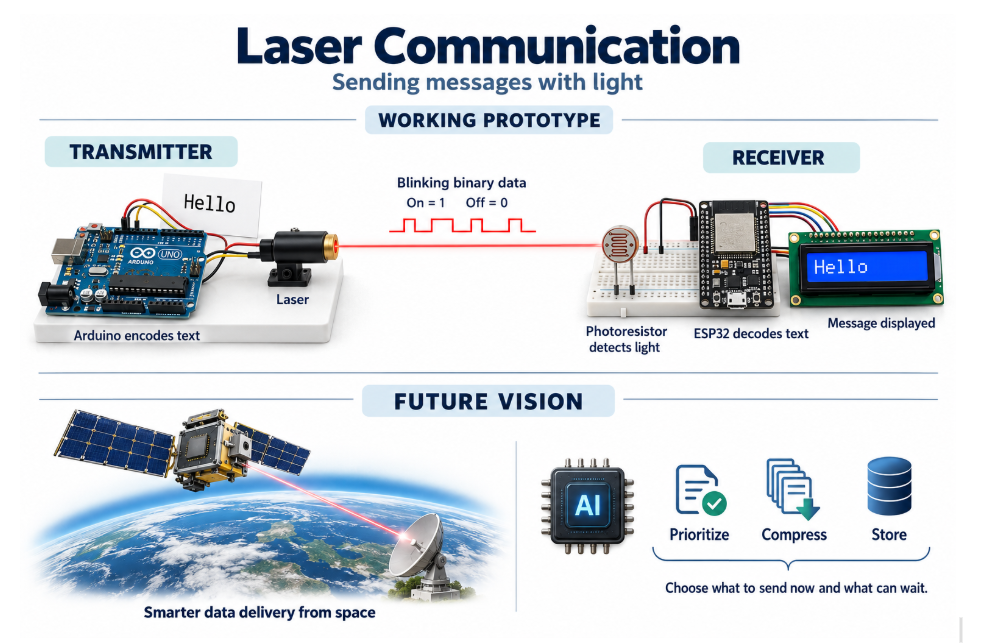

# Laser Communication Project Overview

Our project explores how laser communication and intelligent data management could help future space systems handle large amounts of information. We built a tabletop optical communication prototype that sends a text message from an Arduino to an ESP32 using a laser. The Arduino converts the message into binary data and switches the laser on and off to represent the bits, a method called on-off keying. At the receiver, a photoresistor detects the changes in light, and the ESP32 decodes the signal back into text. An LCD connected to the ESP32 displays the received message, making the complete transmission process visible.

Our motivation is the growing need to move useful information between satellites, possible future data centers in space, and Earth. Collecting data is only part of the challenge; systems also need to decide what deserves immediate transmission and what can wait. Our software design includes a decision layer that considers a message's urgency, importance, and value when selecting it for transmission, compression, or storage. Emergency messages would receive priority, while routine information could be grouped, compressed when worthwhile, or retained until a communication opportunity becomes available. The current optical prototype provides a foundation for exploring that approach. Our goal is to improve how a limited communication link is used while developing an alternative optical transport method. The prototype demonstrates the communication concept; higher transfer speeds and the benefits of intelligent data selection still require measurement.

